# Polish session report — Nov. 5, 2026

Six commits on `main`, each deployed green by the "Update results" workflow (which now also runs on push).
JS bundle 327 KB → 64 KB gzipped. Lighthouse mobile: Performance 95–100, Accessibility 100, Best Practices 100.

## Flagged for you

1. **NY-21 call mismatch.** civicAPI (and Decision Desk HQ) call it for Anthony Constantino (R, +2.1). AP had not called it as of Nov. 5 (Spectrum News Nov. 4 evening; NCPR Nov. 5). Left as civicAPI reports it; nothing was changed. The other 26 races called within 3 points all match AP (sources in the AP cross-check below).
2. **Embed listener.** You asked me to ask which repo holds the WPR listener. Unable to ask, I matched the fleet convention used by wpr-auto-loan and wpr-tip-desk: `{type: "wpr-embed-height", id: "wpr-national-midterm-2026", height}`, plus wpr-auto-loan's `?host=` hand-off so "Copy link" produces an article link. Snippet in CLAUDE.md. Please confirm that is the listener you meant.
3. **Wisconsin shortcut: proposal, not built** (see below).
4. **Ballot measures tab** (stretch) not started.
5. **civicAPI's `% reporting` lags AP** on several called races (TN-09 87.6, NJ-02 85.3, NY-02 80.7, TN-07 93.5, TN governor 90.9). It is civicAPI's figure, labeled as such; nothing to fix on our side.
6. Live stories seen while checking calls, not verified: GA-01 (Hollowell plans to contest after certification), AR-02 (provisionals counted into next week; recount not ruled out), NC-14 (Womack's pending charge).

## Wisconsin shortcut — proposed design

Recommended: two small pieces, both data-driven from what is already loaded.

- **A "Wisconsin" chip** in the map toolbar beside "Jump to a state". One tap selects WI on whichever tab is open (`#house-wi`, `#governors-wi`; on the Senate tab, where WI has no 2026 race, it opens the state panel that lists the governor race and the eight House seats). On the maps, WI gets a thin teal outline at rest so readers can find it.
- **"Wisconsin at a glance"** at the top of the overview panel, under the popular-vote block on the House tab: the governor result row and the 8-seat delegation bar (`4 D, 4 R`), each row clickable. Hidden once the reader has picked a state, so it never competes with the state panel.

Rejected: opening the page on `#governors-wi` by default (the national headline is the story), and a `?focus=wi` embed parameter (invisible to readers who arrive by link).

## What changed, by phase

### 1. Speed and correctness
- us-atlas moved out of the bundle into `public/data/us-albers-10m.json` (one committed copy, also read by `build.py` and `hexmap.mjs`); `us-atlas` and the full `d3` package dropped. No chunk warning.
- AP spot-check of all 27 races civicAPI called within 3 points: 26 agree, NY-21 flagged (above).
- Vitest: 32 tests over `status.ts`, `summary.ts`, `share.ts` and `format.ts` against a frozen fixture of 19 real races. CI runs them before building.
- `build.py` fails on two winners, a winner plus runoff finalists, negative votes, shares past 100%, reporting outside 0–100, a statewide race with no seat holder, or county rows more than 2% off the statewide total (real data is within 0.3%).

### 2. Embed and sharing
- iframe height via ResizeObserver in the fleet's message shape; "Copy link" button for the current view; Open Graph and Twitter tags; `share.png` (1200×630) rendered from the same seat tallies as the tabs on every build, with the data timestamp stamped onto the og:image URL; "may be out of date" notice after three hours.

### 3. Design and UX
- Hex cartogram: interior holes filled (layout regenerated; 50 states contiguous, one hex per district).
- Keyboard: hexes have a roving tabindex, arrow keys walk the grid, Enter selects, the tooltip follows focus; states and chips get the same ring; chamber tabs follow the WAI-ARIA tabs pattern.
- Counties mode zooms to the clicked state with an "All states" control; strokes don't scale; no animation under `prefers-reduced-motion`.
- Results refetch every 15 minutes and on tab focus; the old render dims while loading; a failed refresh shows a specific notice and keeps the last good data.
- Phone table: names no longer break mid-word, Status wraps instead of clipping, district codes don't split at the hyphen. Chamber-tab footers stack under 960 px. Muted text darkened to pass AA on cream (3.98:1 → 5.1:1).

### 4. Reader value
- "Latest calls" on the overview panel: the eight newest calls for the office, with relative times; calls civicAPI gave no timestamp are skipped and the note says so.

### 5. Quality gates
- Fonts self-hosted and preloaded (the Google Fonts stylesheet was the render-blocking request behind a 4 s LCP). Map shapes load after first paint behind a fixed-ratio placeholder. A margin collapse in the loading state caused the only layout shift; fixed. `<main>` landmark added; stray `aria-label`s removed.
- `npm audit`: 0 vulnerabilities. `npm run screens`: zero console errors across 14 views × 4 widths. Actions: green on every push.

## Review pass (evening)

A second pass against the craft, Web Interface Guidelines and mobile-native checklists, a worst-case-data stress test, and a survey of what AP, Decision Desk HQ, NBC, ABC and PBS shipped this cycle (NYT, Post, Bloomberg, CNN and Politico block fetching; their rows rest on secondary write-ups).

Built from the survey: a "Still counting" county mode showing where votes remain (DDHQ's "Remaining"); a "No votes yet" map state so an early lead is never painted (NYT's gray); per-race update times on the card (AP, DDHQ); data-driven map descriptions for screen readers (the 2024 audits' main complaint); the Dec. 12 date on Louisiana runoff cards and the Nov. 18 timing on Alaska's ranked-choice note; "Seat decided … winner not called" wording for California's same-party finals. Already in place before the survey: the uncalled list sorted by margin with leader and % in, the "N not called" counter, the latest-calls feed, the table as the maps' text twin, a search shortcut.

From the checklists: hover states gated to devices that can hover, press feedback, no tap flash, 16 px touch inputs, a skip link, one status line for assistive tech, print styles. The stress test (70-character names, one-glyph names, 100% shares) found and fixed a horizontal overflow in the race card.

Skipped on purpose: a sticky balance-of-power strip (position: sticky cannot work inside the auto-height iframe), needles or win probabilities (no model), swing arrows vs. 2024 (no county baselines under the redrawn maps), incumbent asterisks (civicAPI flags about 50 of 370).

## Candidate photos (late evening)

`npm run headshots` resolves a photo for the top two candidates in every race: 543 of 1007 candidates, a photo for the leader in 438 of 506 races (355 official congressional portraits, public domain; 188 from Wikimedia Commons under CC BY, CC BY-SA, CC0, public domain or Commons free use, each credited on `credits.html`). Photos appear on race cards only; mixed rows in the panel lists looked uneven and were reverted.

Sourcing rules, each one earned by a real mismatch during the run: Wikidata labels get the same suffix handling as candidate names (otherwise "Nick Begich III" matched his grandfather); anyone with a date of death or born before 1920 is rejected (an 1844 legislator came back as Paul Barringer); the Wikipedia article's lead image is used rather than Wikidata's image claim (Begich's claim was the grandfather's portrait); state seals, flags and logos are rejected as placeholders (Zach Lahn's infobox); a missing Congress portrait falls through to Wikipedia (a new member crashed the first run). Every Commons match was reviewed on a contact sheet. Two to eyeball yourself: Rebecca Bennett (NJ) in a flight helmet, which is her article's lead image (she is a former Navy helicopter pilot), and Mark Teixeira (TX) in a Yankees uniform, who really is the TX-21 candidate. John E. Sununu is pinned in `pipeline/headshots-overrides.json` because his father shares the normalized name.

## Ballot measures tab (night)

A fourth tab: 133 statewide measures in 35 states (civicAPI's Referendum, Proposition and Ballot Measure types with `election_type` Statewide and a Yes/No answer set; one six-option "official state firearm" vote is excluded by that rule, and Massachusetts's blank-ballot lines fold into "Others"). Measures are races with office `B` and Y/N answers, so the cards, county maps, table, tooltips, latest-calls feed, Wisconsin block and status rules all reuse the existing code with a teal/brown pair instead of blue/red. The national map shades states by how many measures they have; each measure's card has its own Yes/No county map. The hero dek gains a sentence once any measure is called. Routes: `#measures`, `#measures-wi`, `#measures-wi-179849`. Not included: local referendums (about 2,300).

## Compact embed and device checks (Nov. 6)

`compact.html` is a second embed: the four balance-of-power cards and the six latest calls, one results fetch, no maps, laid out 1, 2 or 4 across by container width, every card and row linking to the full page (or the hosting article via `?host=`). It posts its own embed id so both embeds can share a page. Snippet in CLAUDE.md.

Touch behavior was checked on the live site under Playwright's Pixel 7 (Chromium) and iPhone 14 (WebKit) emulation: 16 of 16 checks pass on Chromium and 15 of 16 on WebKit, where the one "failure" is WebKit not exposing the tap-highlight property to `getComputedStyle` (the rule is in the stylesheet). Covered: coarse pointer without hover, transparent tap highlight, 16 px inputs, zoomable viewport with safe-area cover, no horizontal overflow, icon-only copy link, hex tap opening the state list, district row tap, no hover state left behind, county-mode zoom and return, copy link response. Not provable in emulation and worth two minutes on a real phone: sticky hover after a tap, the tap delay feel, pull-to-refresh and rubber-banding inside the WordPress page, the home-indicator safe area, and the keyboard over the search box.

## Sponsorship (Nov. 6)

The title placement under the headline follows the tracker model from the brand kit: one config object (`src/sponsors.ts`), a sold lockup (logo or name, tagline split at the em dash, Directions chip, UTM-tagged `sponsored` link), an open-slot upsell with Chris Weber's address and a copy-to-clipboard mailto, a `?demo` preview for sales, and an "Advertise on this page" footer link. The slot ships open.

## Race tables (Nov. 6)

Every office's table now expands a row into the full race card (all candidates with votes and bars, photos, call and update times, the count sparkline, an "Open on the map" button), adds Votes and Called columns, sorts on every column, filters to races within 5 points, shows a called/not-called summary, and downloads the filtered rows as CSV with the top two candidates spelled out.

## Map pass (Nov. 6)

The key is now a spotlight filter: press "Democrat leads", "Seat flipped" or "Called in the last 3 hours" and every other state or hex dims. Hover draws an ink outline instead of darkening the fill, fills cross-fade when a refresh changes a call, the maps fade in once on load and sit on one soft shadow, fresh calls get a dashed teal ring, the tooltip leads with the leader's headshot and share bars, and a zoomed state names its five biggest counties (Dallas, Travis, Bexar, Harris, El Paso in Texas) with overlap avoidance. Proven at 390/768/1280/1600 (`senate-spotlight-*`, `senate-spotlight-legend-*`, `senate-hover-*`, `house-hover-*`, `senate-counties-tx-*`); no console errors.

## Statement features (Nov. 6)

**Replay election night.** A play button and scrubber above the map walk the 491 timestamped calls in order; the maps, tabs, headline, panel and table show the results as they stood after each one, the readout names the race just called, and the "called in the last 3 hours" rings follow the replay clock. Before a call a state shows today's leader in a pale tint (the count history starts Nov. 5, so there is no earlier lead to show); the 34 calls civicAPI did not timestamp land at the end. `senate-replay-*` (8:21 p.m. Nov. 3, 120 calls in), `house-replay-*` (8 p.m., 60 calls in).

**Since you were last here.** A strip under the tabs lists the races called since this browser last had the page open, five named with the winner and a count of the rest; it lives in the browser alone and is dismissable. `senate-since-*` (seeded with a visit five hours before any call).

**How close the House was.** All 435 districts as dots on one margin axis on the House overview, Democratic wins left, Republican right, Wisconsin's eight outlined, the 87 and 8 safe seats past 38 points as labeled bars. `house-margins-*`.

**Print.** The page prints as the tallies, the map and the table, without controls, sponsor upsells or the replay.

## Visual pop (Nov. 6)

Each chamber card now carries a parliament arc: every Senate, House and governor seat and every ballot measure as a dot in a half circle, secured seats at the ends, leads pale, the undecided in the middle under the majority tick. The dots pop in from both ends toward the middle on load and recolor live during the replay. The cards' numbers run up from zero on load, the headline sets the party names in their colors, and tooltips fade up. Proven at 390/768/1280/1600 in `senate-*` (hero and cards) and `house-replay-*` (arcs mid-replay).

## Quality re-check after the visual work (Nov. 6)

Lighthouse had dropped to 81–82 on some runs. Bisecting across the day's commits in worktrees showed the same bimodal
scores on the pre-map-pass build, and the trace showed why: the simulation charges the headline's paint to every file
observed before it, and on a zero-latency local server the deferred county and atlas files landed first. Three real fixes
came out of it (the deferred fetches wait two frames and 150 ms after the first app frame; the seat arc is memoized so the
count-up's per-frame renders never re-render 700 dots; the dots fade with opacity only instead of a transform) plus a
40 ms round trip in the gzip server so the lab order matches a real host. Result: 100 or 94 (LCP 3.1 s simulated) depending
on whether the loading flag painted before the app frame; accessibility 100 throughout. Also: the hover outline on the
maps is no longer set by touch (a finger never sends pointer-leave), and print disables the entrance animations.

## Lighthouse (mobile, gzip-served build, two runs per view)

| View | Performance | Accessibility | Best Practices | LCP | CLS |
|---|---|---|---|---|---|
| Before (#senate) | 83 | 96 | 100 | 4.1 s | 0.11 |
| #senate | 100 / 96 | 100 | 100 | 0.8 / 2.7 s | 0 |
| #house | 100 / 100 | 100 | 100 | 0.8 / 0.8 s | 0 |
| #governors | 96 / 95 | 100 | 100 | 2.8 / 2.7 s | 0 |

Full report for one run: [lighthouse-mobile-senate.html](lighthouse-mobile-senate.html). Measured with `node scripts/serve.mjs 4174`, which gzips like GitHub Pages; Vite's preview server does not, which understates the scores.

## Before / after

| View | Before | After |
|---|---|---|
| Senate, 1280 | 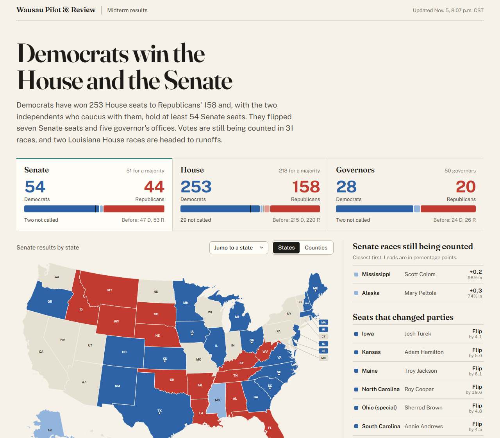 | 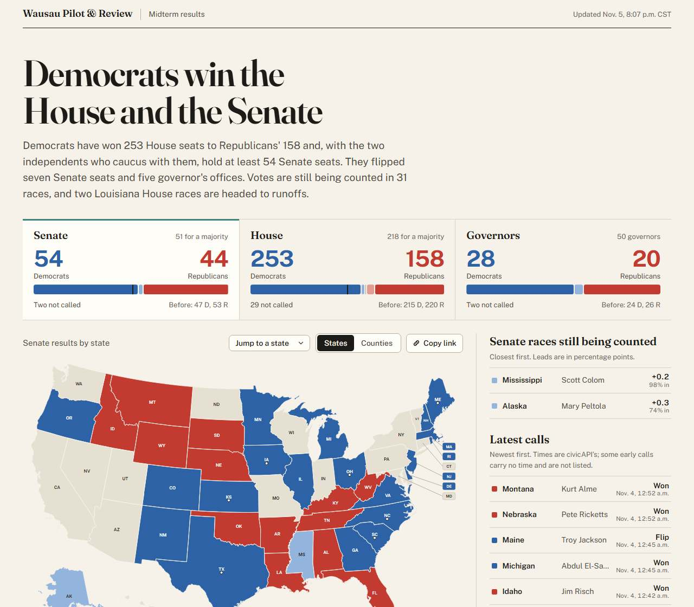 |
| House, 1280 | 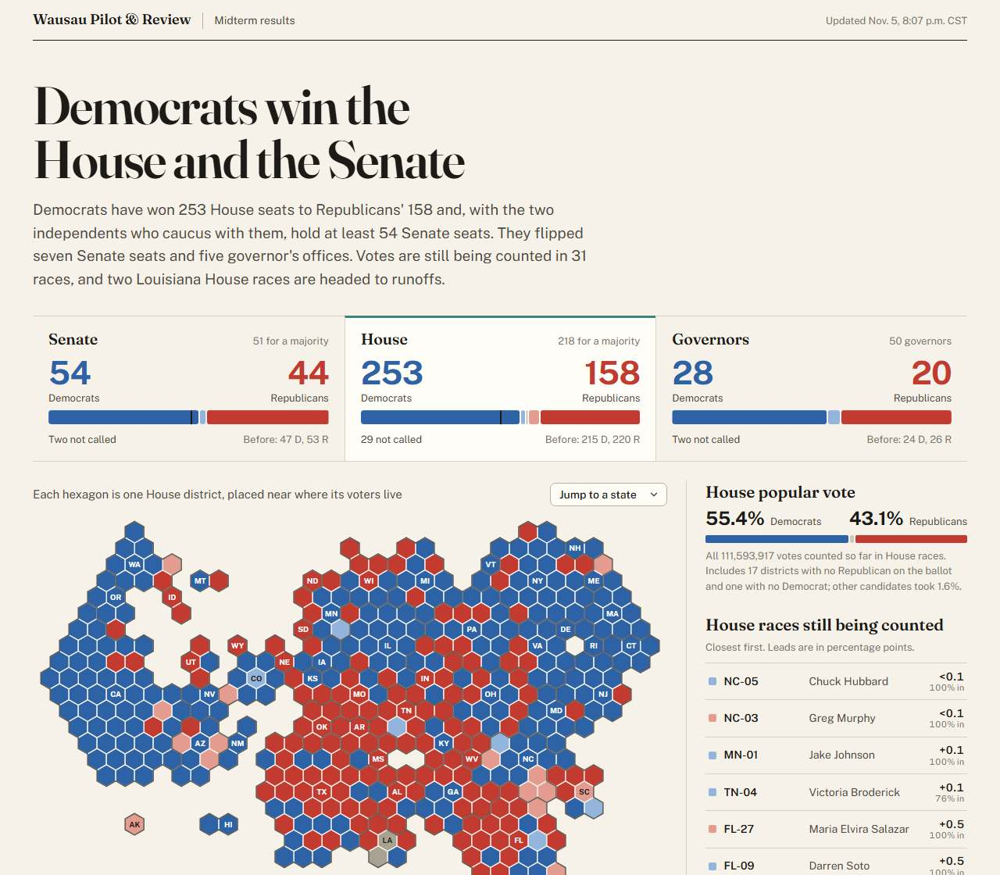 | 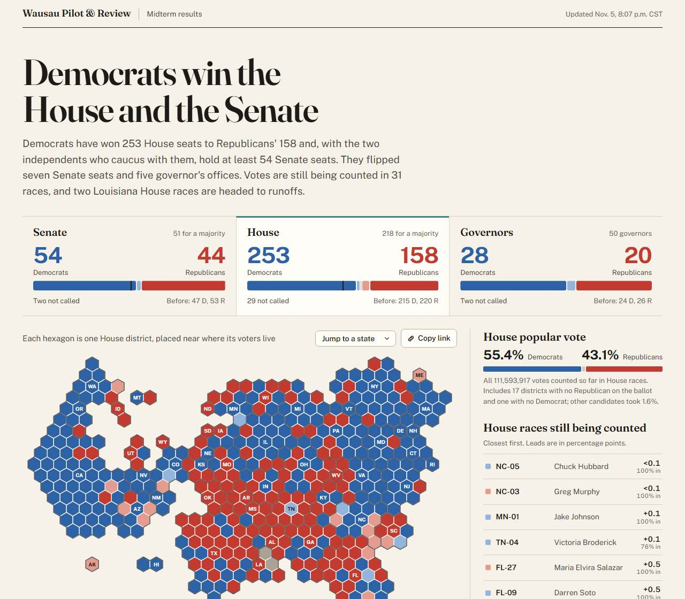 |
| House hex map hover, 1280 | 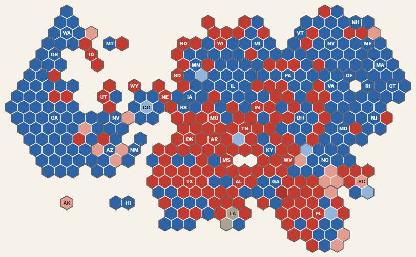 | 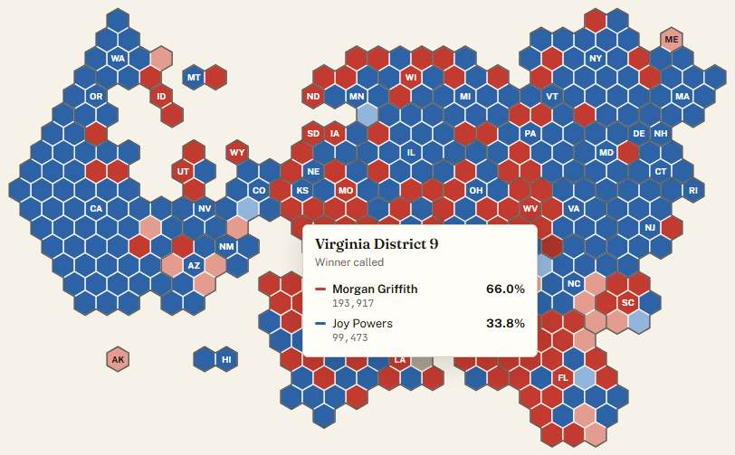 |
| Senate, 390 | 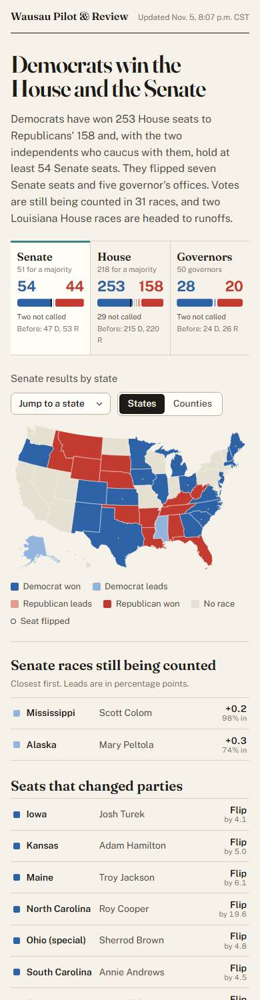 | 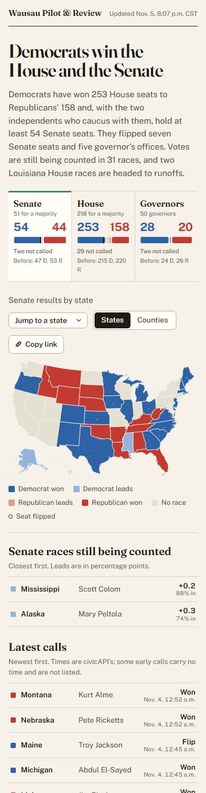 |
| WI-03 panel and table, 390 | 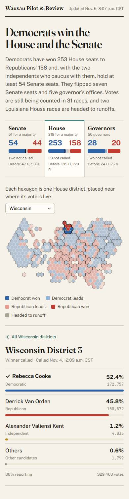 | 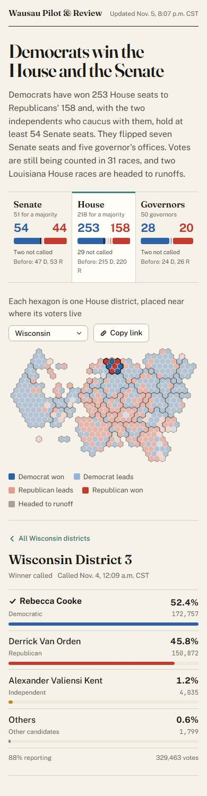 |
| Wisconsin House, 768 | 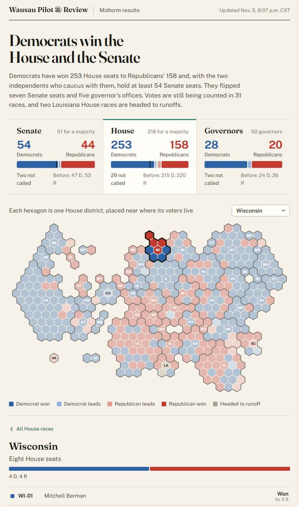 | 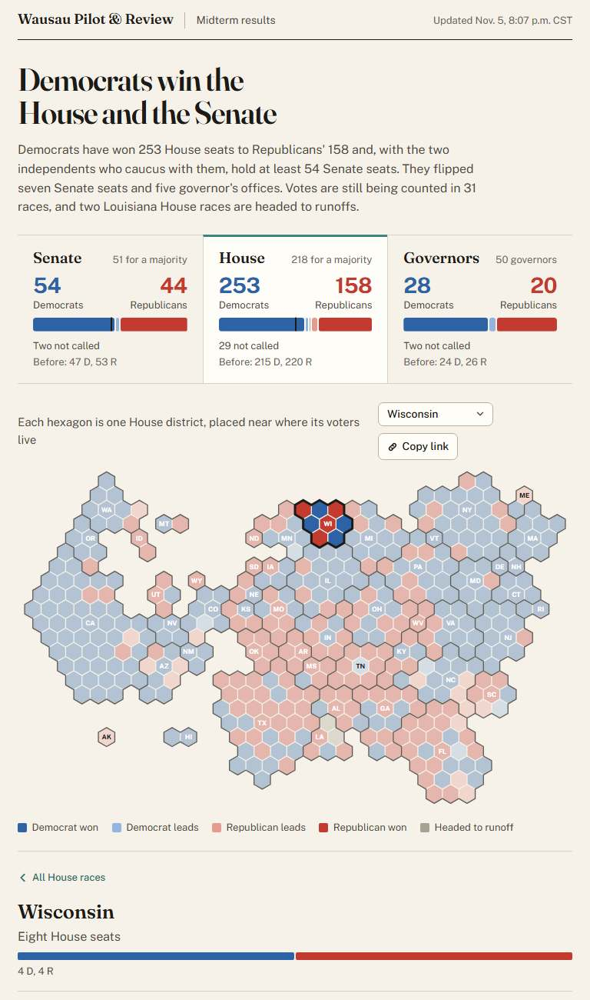 |
| Senate counties, 1600 | 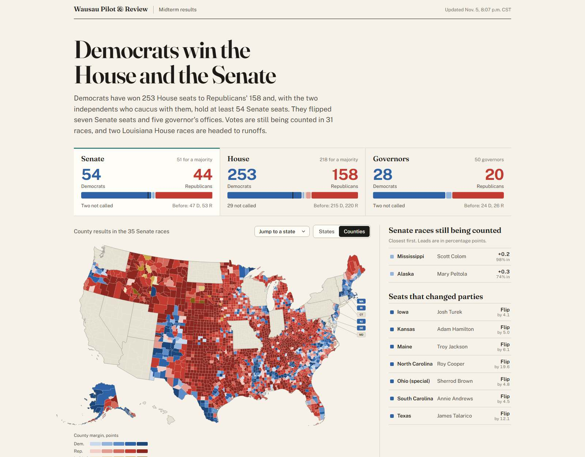 | 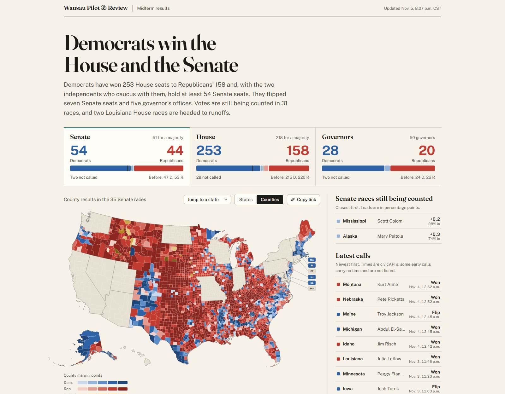 |

New views: counties mode zoomed to Texas ([senate-counties-tx-1280-after.jpg](senate-counties-tx-1280-after.jpg)), keyboard focus on a hex with its tooltip ([house-keyboard-1280-after.jpg](house-keyboard-1280-after.jpg)), the share card ([share-after.png](share-after.png)).

## AP cross-check (27 races called within 3 points)

| Race | civicAPI | AP | Source |
|---|---|---|---|
| TN-09 | Taylor R +1.1 | Called for Taylor, Nov. 5 | fox17.com, timesfreepress.com |
| OH-10 | Knickerbocker D +1.6 | Called, Nov. 5 | whio.com |
| NY-21 | Constantino R +2.1 | **Not called** | spectrumlocalnews.com, northcountrypublicradio.org |
| NC-09 | Ojeda D +2.2 | Called, Nov. 5 | rollcall.com |
| NC-14 | Womack D +2.2 | Called, Nov. 5 | wtop.com (AP wire) |
| NC-06 | Jefferson D +2.3 | Called, Nov. 5 | wtop.com (AP wire) |
| VA-01 | S. Taylor D +2.4 | Called, Nov. 5 | vpm.org |
| NC-13 | Barringer D +2.4 | Called, Nov. 5 | kare11.com (AP) |
| NJ-02 | Mullock D +2.7 | Called, Nov. 5 | inquirer.com |
| FL-13 | Luna R +0.8 | Called, Nov. 5 (civicAPI called Nov. 3) | baynews9.com |
| OK-05 | Bice R +1.3 | Called | newson6.com |
| FL governor | Donalds R +1.3 | Called, Nov. 3 | npr.org |
| AR-02 | Hill R +1.7 | Called, Nov. 5 | katv.com |
| LA Senate | Letlow R +1.8 | Called, Nov. 3 | lailluminator.com |
| MI-04 | McCann D +1.8 | Called, Nov. 4 | michiganpublic.org |
| TX-02 | Toth R +2.0 | Called, Nov. 4 | wtop.com (AP wire) |
| FL-04 | Bean R +2.1 | Called, Nov. 3 | baynews9.com (AP wire) |
| VA-05 | McGuire R +2.2 | Called, Nov. 5 | wric.com |
| TN-07 | Van Epps R +2.2 | Called, Nov. 5 | cbsnews.com |
| NY-01 | LaLota R +2.2 | Called, Nov. 5 | wtop.com (AP wire) |
| NY-02 | Garbarino R +2.3 | Called, Nov. 5 | yahoo.com (AP wire) |
| TX-27 | Cloud R +2.3 | Called, Nov. 4 | wtop.com (AP wire) |
| TN governor | Blackburn R +2.5 | Called, Nov. 4 | wsmv.com |
| GA-01 | Kingston R +2.8 | Called, Nov. 4 | wtoc.com |
| FL Senate special | Moody R +2.9 | Called, Nov. 3 | jaxtoday.org |
| TX-32 | Yarbrough R +2.9 | Called, Nov. 4 | wtop.com (AP wire) |
| TX-05 | Gooden R +2.9 | Called, Nov. 4 | foxnews.com (AP calls) |

## Fresh-eyes pass (Nov. 7)

A screenshot audit of every view at the four widths, looking for rough edges the feature rounds left. Four turned up:
the share image still carried flat bars while the page had moved to parliament arcs (it now draws the arcs, the
headline a step smaller to make room); the race table overflowed sideways between 700 and 960px by up to 134px even
after hiding the call time, so Reporting, Votes and Called now hide on tablets (every number is in the expanded row);
the Wisconsin glance listed Question 2, 3, 1 above the governor (civicAPI id order), so measures now sort in natural
title order in the pipeline and the glance leads with the statewide offices; and the screenshot gate flagged a headshot
request the tooltip aborted when keyboard focus moved on, which is not a broken file, so aborted loads no longer count.

## Interactive arcs (Nov. 7)

Every dot in the four chamber cards now stands for a known seat: `chamberSeats` lays the Senate's and governors' holdovers
at the edges and sorts each block by margin so the closest races meet in the middle. Hovering a dot shows the race tooltip
(headshot, status, call time or % reporting, share bars); clicking it opens the race. The card had been one `<button>`,
which cannot contain interactive dots, so the tab role moved to a button holding the name and counts while the card div
takes the office click. Phones keep the tap-the-card behavior (`pointer-events: none` on dots under a coarse pointer).
The ring is thicker (inner radius 40 to 34, outer 96 to 98) and the card padding tighter, so the arcs grew about 5%
at desktop widths without changing the strip's height. A screenshot-script bug surfaced on the way: an element
screenshot scrolls its target into view, and that scroll moved the pointer off the hovered dot, so clips now scroll into
view before any hover.

